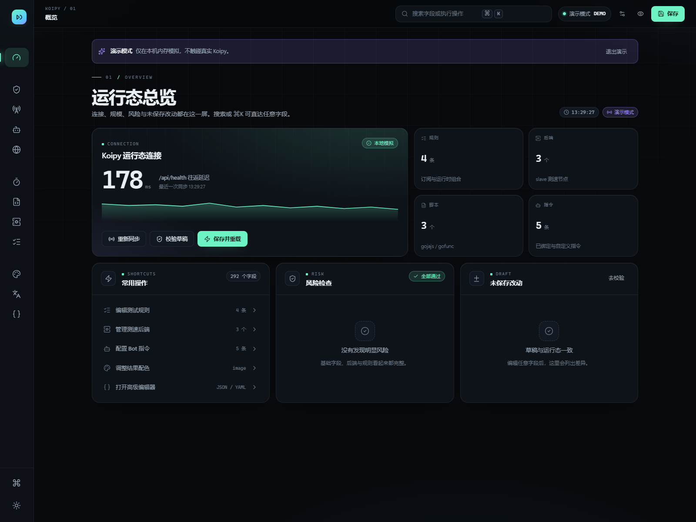
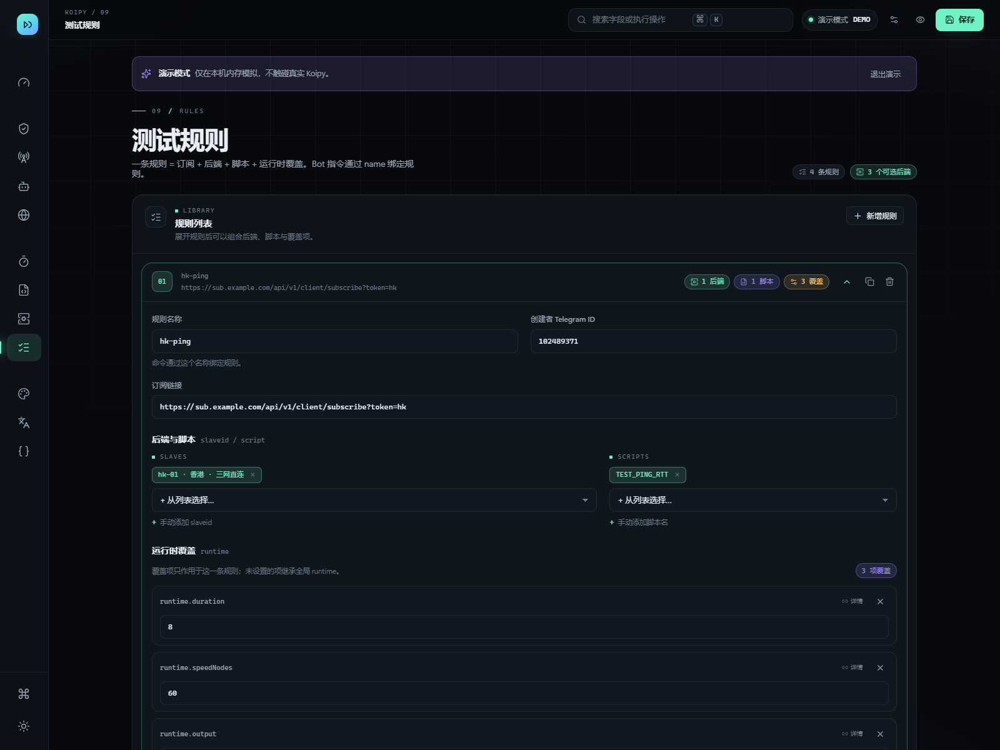
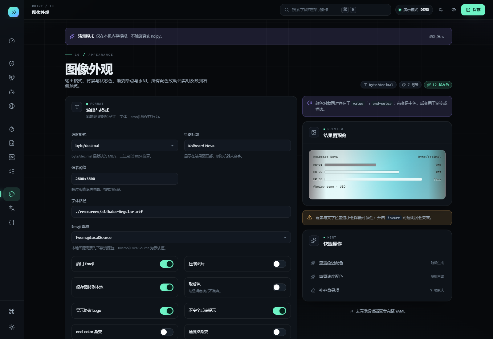
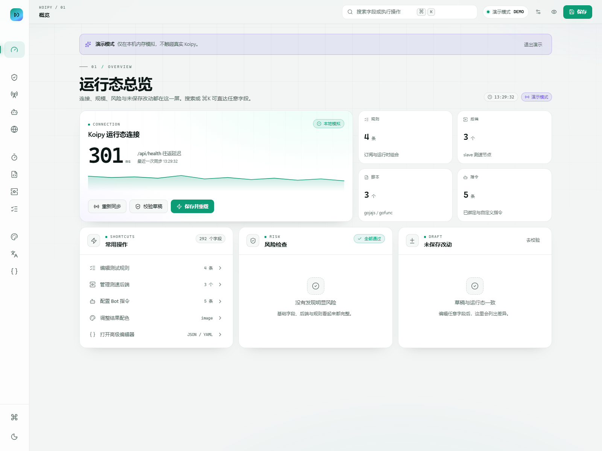
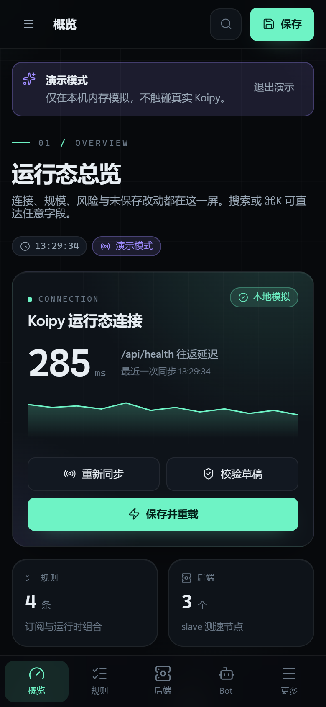
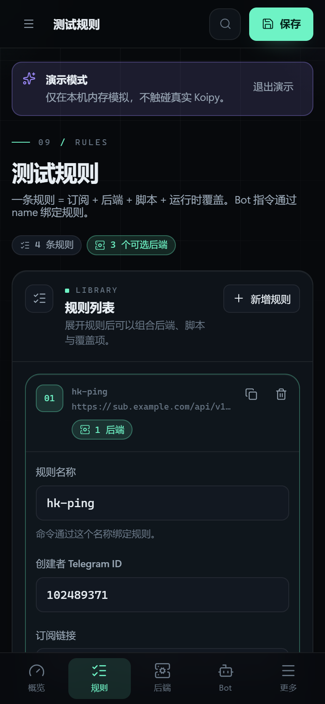

# Koiboard Nova

Koipy 的独立前端控制台，完全重写自 Koiboard V3 的 UI 层：同一套 Koipy Web API，重新设计的排版、动效与交互路径。

- 只负责 UI、草稿与 API 调用，不含后端
- 桌面端为「图标轨道 + 命令面板 + 底部草稿坞」，移动端为「底部标签栏 + 全屏导航」
- 键盘优先：⌘K 搜索任意字段、⌘S 保存、⌘Z 撤销
- 内置演示模式，无需后端即可完整体验

## 预览

| 桌面 · 总览 | 桌面 · 规则 | 桌面 · 外观 |
| --- | --- | --- |
|  |  |  |

| 浅色主题 | 移动端 · 总览 | 移动端 · 规则 |
| --- | --- | --- |
|  |  |  |

## 设计取向

1. **一眼一层**：总览只回答「连上了吗、有多大、有没有风险、改了什么」；细节留在分区里。
2. **渐进披露**：列表用可展开行，复杂覆盖项（规则 runtime）只显示显式设置的键，其余继承全局。
3. **状态可见**：连接灯、延迟火花线、字段级未保存圆点、底部草稿坞、敏感性提示。
4. **手感优先**：统一 150–300ms 缓动、展开动画、视图切换与滚动重置，全部尊重 `prefers-reduced-motion`。
5. **随手可回退**：整份草稿的撤销/重做、单字段还原、全部还原、丢弃并重载。

## 功能

- 从 Koipy 运行态读取配置并生成本地草稿
- 覆盖全部配置分区：`license` / `admin` / `user` / `log-level`、`webapi`（只读）、`bot` + `callbacks`、`network` + `subscription.age` + `subconverter`、`runtime`、`scriptConfig`、`slaveConfig`、`rules`、`image`、`translation`
- 图像外观完整覆盖：速度格式、标题/字体/emoji、7 项背景色对象、12 项状态色、outColor、延迟/速度断点、水印全参数
- 后端高级连接：mTLS、客户端证书、CA、专属代理、反向连接、上行测速与 DNS 配置
- 多后端调度与状态展示严格按 Koipy 取值：`concurrent/pipeline/sequential`、`emoji/number/default`
- 校验草稿、写入内存、保存到 `config.yaml`、保存并重载、丢弃草稿并重载
- 规则级 runtime 覆盖编辑器（键级增删，继承全局）
- 指令 / 脚本 / 后端 / 规则的可展开行编辑，支持新增、复制、排序、删除
- 图像配色：背景、延迟与速度断点，渐变实时预览 + 一键生成配色
- 字段搜索、字段详情抽屉（说明 / 类型 / 当前值 / 运行态值 / 风险）
- 敏感字段默认脱敏，可临时显示；`webapi` 根配置只读保护
- JSON 整份草稿编辑（语法检查 / 格式化 / 应用）与 YAML 预览、导出
- 深色 / 浅色主题，首屏无闪烁，选择写入 `localStorage`
- 演示模式：内存模拟全部读写，适合评审与截图

## 快速开始

环境：Node.js 20+（建议 22+）与 npm。

```powershell
npm ci
npm run dev -- --host 127.0.0.1 --port 5288
```

打开 `http://127.0.0.1:5288/`。

先看效果（无需 Koipy）：

```text
http://127.0.0.1:5288/?demo=1&theme=dark
```

演示模式也支持 `?view=rules`、`?panel=palette|nav|connect` 深链，便于分享具体界面。

## 连接 Koipy

1. 顶部「连接设置」（或命令面板里的「连接设置」）填写：
   - **API 地址**：同源部署留空；跨域部署填写 `http://127.0.0.1:8899`
   - **访问密码**：对应 `webapi.password`
2. 勾选「记住密码」才会写入 `localStorage`，取消勾选立即清除。
3. 连接成功后自动读取 `GET /api/config`。

跨域时必须在 Koipy 配置里放行前端来源：

```yaml
webapi:
  allowOrigins:
    - http://127.0.0.1:5288
```

## 写入语义

| 操作 | 接口 | 影响 |
| --- | --- | --- |
| 写入内存 | `PUT /api/config` | 只更新运行态，不写文件 |
| 保存 | `POST /api/config/apply` `mode=save` | 校验 → 内存 → `config.yaml` |
| 保存并重载 | `mode=save_reload` | 写文件并让 Koipy 重新加载 |
| 丢弃并重载 | `mode=discard_reload` | 丢弃草稿，从文件恢复 |

底部草稿坞会在存在未保存改动或任务进行时出现，保存实时显示阶段（校验 / 写入 / 应用）。

## 快捷键

| 快捷键 | 动作 |
| --- | --- |
| `⌘K` / `Ctrl+K` | 打开命令面板（字段、视图、操作、改动） |
| `⌘S` / `Ctrl+S` | 保存 |
| `⇧⌘S` | 保存并重载 |
| `⌘↵` | 校验草稿 |
| `⌘Z` / `⇧⌘Z` | 撤销 / 重做（输入框内保留原生行为） |
| `Esc` | 关闭面板、抽屉、导航 |

移动端：底部标签栏切换「概览 / 规则 / 后端 / Bot」，第五项「更多」打开全屏导航；顶部仅保留搜索与保存，其他操作收进命令面板。

## 目录结构

```text
src/
  App.tsx                     # 壳层：路由、主题、快捷键、面板编排
  components/
    Shell.tsx                 # 轨道导航、顶栏、移动标签栏、草稿坞、导航弹层
    CommandPalette.tsx        # ⌘K 命令面板
    Inspector.tsx             # 字段详情抽屉
    Field.tsx                 # 字段渲染与 ConfigBinding 契约
    Row.tsx                   # 可展开行
    ChipPicker.tsx            # 多选 chip / 手动追加
    RuntimeOverrides.tsx      # 规则级 runtime 覆盖编辑器
    ArrayEditor.tsx           # 字符串数组编辑器
    Connect.tsx               # 连接表单
    ui.tsx / icons.tsx        # 基础组件与图标注册表
  views/                      # 12 个分区视图
  hooks/
    useKoipyConfig.ts         # 草稿生命周期、历史、校验、保存、演示开关
    useToasts.ts              # 通知队列
  lib/
    api.ts                    # 地址规范化、请求头、演示拦截、导出
    configPath.ts             # YAMLPath 读写、差异、脱敏、风险、帮助
    readOnly.ts               # webapi 只读保护
    defaults.ts               # 新增项与配色生成
    yaml.ts                   # 草稿序列化为 YAML
    mock.ts                   # 演示配置
  data/metadata.ts            # 分区、字段说明、保留脚本名、runtime schema
  styles/                     # base / layout / components 三层样式
tools/test.mjs                # 交互回归脚本（Playwright + 本机 Edge）
docs/design-system.md         # 设计系统与交互规范
docs/api.md                   # API 契约与演示模式说明
```

## 与旧版的关系

- 复用：API 契约、YAMLPath 逻辑、字段说明、默认值、只读保护、脱敏规则。
- 重写：全部页面结构、样式系统、导航、编辑交互、动效、移动端布局。
- 增强：命令面板、字段级差异与撤销重做、规则 runtime 键级覆盖、移动端底部导航、演示模式、草稿序列化 YAML、保存后敏感变更提示。

## 部署

静态构建：

```powershell
npm run build
```

产物在 `dist/`。推荐同源反向代理：

```text
https://example.com/        -> dist/
https://example.com/api/*   -> Koipy Web API
```

Nginx 模板见 `nginx.conf.example`（含 `/api/` 代理与 SPA 回退）。Docker：

```powershell
Copy-Item nginx.conf.example nginx.conf
docker compose up -d --build
```

## 开发与校验

```powershell
npm run build          # tsc + vite build
npm run preview        # 默认 http://127.0.0.1:5289
npm run smoke          # 交互回归（需要本机 Edge 与已启动的 preview）
```

回归脚本覆盖：草稿出现 / 撤销重做 / 校验 / 保存 / 新增与删除规则 / runtime 覆盖增删 / 命令面板 / 抽屉 / 行展开 / 移动端布局与导航 / 运行时错误。

## 维护指南

新增一个配置分区：

1. `src/types/config.ts` 的 `SectionId` 增加 id
2. `src/data/metadata.ts` 的 `sections` 增加元数据（编号、分组、图标、roots）
3. `src/views/` 新建视图（接收 `model`、`binding`、`onInspect`）
4. `src/App.tsx` 的 `viewMap` 注册
5. 需要默认项时补 `src/lib/defaults.ts`；禁止前端写入时补 `src/lib/readOnly.ts`
6. `npm run build` + 回归脚本

字段说明优先参考 Koipy 的 `resources/config.example.yaml` 与真实 `/api/config` 返回；修改字段路径时同步 `metadata.ts`、对应视图与 `configPath.ts` 的风险规则。
